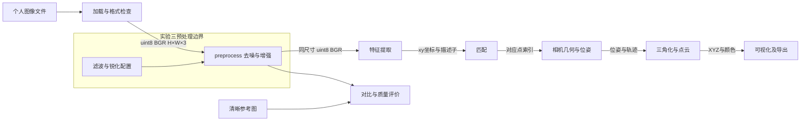

# SFM 系统架构与实验三边界

实验三实现预处理模块：uint8 BGR输入，输出同尺寸去噪/增强BGR。加载、保存和日志由外围命令行负责，数值接口不读写文件。后续模块记录设计约定，留待对应实验实现。

| 模块 | 输入 | 输出约定 | 当前状态 |
| --- | --- | --- | --- |
| 加载 | PNG/JPEG路径 | 非空uint8 BGR，H×W×3 | 已实现，灰度扩展/BGRA舍弃Alpha |
| 预处理 | BGR与cfg字典 | 同尺寸/类型/顺序的新数组 | 三已实现并实际调用 |
| 特征 | 图像和参数 | xy像素坐标N×2 float32、描述子N×D和方法/dtype元数据 | 设计约定 |
| 匹配 | 两组描述子 | M×2对应整数索引和距离/置信度 | 设计约定 |
| 几何 | 对应点、内参、轨迹 | K/R/t float64和轨迹，引用原图坐标 | 设计约定 |
| 点云 | 位姿和轨迹 | XYZ N×3 float64，颜色N×3 uint8及尺度元数据 | 设计约定 |
| 可视化 | 点云和相机 | 视图或导出文件 | 设计约定 |

几何采用 X_camera=R@X_world+t，尺度由后续标定决定。预处理不缩放、裁剪或几何变换，像素坐标仍在原图系。数组索引img[y,x]，特征坐标(x,y)。存储为BGR，彩色显示转RGB；本实验灰度评分分支不冒充BGR接口输出。

接口详情见interface_agreement.md。当前为已实现和验证的技术设计；真实小组讨论、签名由实际参与者补充，不编造协商记录。

## 实验四扩展

实验四在灰度分析分支新增Sobel、Canny和阈值分割，输出二维梯度/二值数组及统计，不覆盖preprocess的BGR返回值。已有实验三的架构图和最新结果保留，三至四的函数级数据流见detailed_design.md。编码规范和技术走查分别见coding_standards.md、design_walkthrough.md，真实参与者待办见user_tasks.md。
