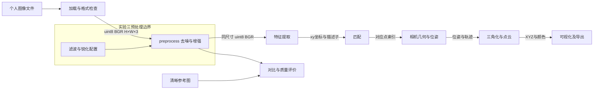

# SFM 系统架构与实验三边界

实验三实现预处理模块：uint8 BGR输入，输出同尺寸去噪/增强BGR。加载、保存和日志由外围命令行负责，数值接口不读写文件。后续模块记录设计约定，留待对应实验实现。

| 模块 | 输入 | 输出约定 | 当前状态 |
| --- | --- | --- | --- |
| 加载 | PNG/JPEG路径 | 非空uint8 BGR，H×W×3 | 已实现，灰度扩展/BGRA舍弃Alpha |
| 预处理 | BGR与cfg字典 | 同尺寸/类型/顺序的新数组 | 三已实现并实际调用 |
| 特征 | 图像和参数 | SIFT KeyPoint列表（含xy/size/angle）、float32 N×128和元数据 | 六已实现，见features.py |
| 匹配 | 两组float32 SIFT描述子 | DMatch列表和完整原始索引/距离/比值，附互查与人工样本 | 七已实现，matching.py |
| 几何 | 对应点、内参、轨迹 | K/R/t float64和轨迹，引用原图坐标 | 设计约定 |
| 点云 | 位姿和轨迹 | XYZ N×3 float64，颜色N×3 uint8及尺度元数据 | 设计约定 |
| 可视化 | 点云和相机 | 视图或导出文件 | 设计约定 |

几何采用 X_camera=R@X_world+t，尺度由后续标定决定。预处理不缩放、裁剪或几何变换，像素坐标仍在原图系。数组索引img[y,x]，特征坐标(x,y)。存储为BGR，彩色显示转RGB；本实验灰度评分分支不冒充BGR接口输出。

接口详情见interface_agreement.md。当前为已实现和验证的技术设计；真实小组讨论、签名由实际参与者补充，不编造协商记录。

## 实验四扩展

实验四在灰度分析分支新增Sobel、Canny和阈值分割，输出二维梯度/二值数组及统计，不覆盖preprocess的BGR返回值。已有实验三的架构图和最新结果保留，三至四的函数级数据流见detailed_design.md。编码规范和技术走查分别见coding_standards.md、design_walkthrough.md，真实参与者待办见user_tasks.md。

## 实验六特征边界

features.py的extract_sift(img,cfg=None)实现上述特征节点：灰度/BGR/BGRA uint8加载边界，返回cv2.KeyPoint与float32 N×128，空特征归一化为(0,128)。实验五Harris在feature.py，两个文件明确区分。

实验六主入口为性能与可观察性显式支持max_input_side，超限时生成等比工作图并记录源像素中心→工作图矩阵；这是外围分析步骤，不修改实验三preprocess的同尺寸契约。后续几何模块应选择工作图坐标与相应内参，或通过矩阵映回原图，不混用坐标尺度。实验六简单KNN与已知生成矩阵误差仅用于不变性验证，通用匹配/相机几何/点云仍属于后续实验。

## 实验七匹配边界

matching.py实现两组SIFT的BF/FLANN KNN、ratio和最近邻互查/双向ratio，索引始终引用当前原始关键点，统计不截断。lab7_annotations.py将最终集合固定抽样，真实标签独立置于data/annotations并绑定数据ID；标注页不产生算法伪真值。实验七使用真实双视角照片，不套用实验六已知变换误差。

本次没有实现实验八RANSAC/拼接或后续相机几何/点云；相应架构节点仍为设计约定。用户已有预处理、SIFT及其他实验最新数据保留。流程、边界和发布见lab7_design.md。
