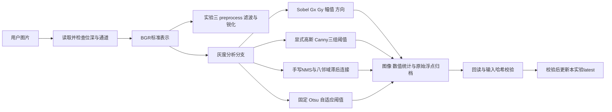

# 实验三至四预处理模块详细设计

范围：已有实验三的滤波/锐化和BGR预处理接口，新增实验四的灰度梯度、边缘和阈值分割。预处理输出BGR，分析分支输出单通道数组，避免把二值边缘覆盖为三通道图像。调用者从文件加载并保存证据；数值函数无文件副作用。

## 数据与边界约定

数组索引为 [y,x]，梯度方向 atan2(Gy,Gx) 使用图像坐标，y向下，弧度。实验三/四输入uint8；灰度H×W，BGR为H×W×3。BGRA在加载处明确舍弃Alpha，uint16/float32不隐式缩放。实验四纹理/光照不均图分别分析，无双图运算，不要求同尺寸；主入口最短边≥5。

Sobel梯度保持float64；显示图用abs/幅值归一化。Canny阈值在原始梯度尺度上使用，L2gradient=True，不能在0–255显示幅值上套用相同阈值。高斯去噪由包装函数显式执行，手写/API使用相同设置。二值输出0/255。Otsu返回选定阈值，固定阈值定义为严格大于。

## 实验三数值函数

| 函数 | 输入/输出 | 算法与异常 |
| --- | --- | --- |
| validate_image | uint8灰度或BGR→校验 | 拒绝空、错误位深或shape，ValueError |
| positive / odd_kernel | 参数→有效数值 | 有限正/非负值；核≥3奇整数，非法拒绝 |
| gaussian_noise | 图、sigma、seed→新含噪图 | float64加噪、clip再转uint8，输入不修改 |
| salt_pepper_noise | 图、概率、seed→图和选中计数 | 一张随机掩码分配黑/白，不支持概率>1 |
| filter_image | 图、method、配置→同shape图 | mean/Gaussian/median/bilateral/none；验证相关核和sigma |
| sharpen_image | 图、method、系数→同shape图 | CV_64F拉普拉斯带符号增强或USM，未知方法拒绝 |
| preprocess | uint8 BGR、cfg→全新BGR | 先滤波后锐化，拒绝灰度/未知配置键，保持输入与坐标 |
| psnr / matching | 两同shape图→分数/校验 | float64差值、MSE=0为∞，形状或类型不符拒绝 |
| ssim / quality | 参考与处理图→分数/元数据 | skimage、range=255、win=7；尺寸过小拒绝，JSON显式表示∞ |
| gradient_mean | 图→平均Sobel梯度 | 彩色先转灰度；指标不是单独的去噪准确率 |

## 实验四数值函数

| 函数 | 输入/输出 | 算法 | 异常与边界 |
| --- | --- | --- | --- |
| require_gray | 数组→校验 | 非空二维uint8 | 类型/位深/通道错误ValueError |
| unit_gray | 非负有限二维float→uint8显示图 | 按最大值映射0–255 | 最大值0返回全黑；NaN/负值拒绝 |
| sobel_gradients | 灰度、kernel3/5→字典 | CV_64F Gx/Gy、hypot、atan2和显示图 | 非法核拒绝；REFLECT_101边界 |
| thresholds | low/high→有限float | 要求0≤low<high | 字符串/bool/NaN/顺序错拒绝 |
| canny_input | 灰度、sigma→新平滑图 | GaussianBlur自动核，sigma0复制 | sigma负/NaN拒绝 |
| canny_edges | 灰度、low/high/sigma→二值边缘 | 显式平滑、Canny aperture3/L2 | 不使用归一化显示图阈值 |
| nonmaximum_suppression | 同shape幅值/弧度→float64 NMS | 四向邻点比较，单侧严格比较打破平台 | 外圈零；太小图全零；非有限/错shape拒绝 |
| hysteresis | 非负NMS、阈值→0/255 | 强种子队列遍历八邻域弱边缘 | 无强种子全零；零背景不因low=0被连接 |
| manual_canny | 灰度和参数→平滑/NMS/边缘字典 | 串联共同平滑、Sobel、手写NMS/连接 | 与API比较，不承诺逐像素一致 |
| edge_agreement | 两同shape二值图→差异/IoU | 集合交并和xor | 空并集IoU=1；无真值时不是准确率 |
| threshold_segments | 灰度、T→fixed/otsu/阈值 | >T、Otsu类间方差 | T需0–255；恒定图由API明确定义 |
| adaptive_segment | 灰度、奇窗口、C→二值 | Gaussian局部统计-C | 窗口≥3奇整数，C有限 |
| uneven_illumination | 个人灰度、左右增益→图/增益数组 | 横向线性增益乘法与clip | 0<left<right≤1，至少两列 |
| binary_statistics | 二值图→白色量与左右比例 | 非零计数 | 拒绝非0/255；单列仅整体统计 |

## 文件、配置与结果流程

run_lab4.py 的source_path/load_gray负责路径与uint8/最短边校验；run负责派生光照、调用模块、统计、PNG/NPZ回读与哈希。report_text负责依据实际统计写报告；main负责argparse/虚拟环境/ERROR及退出码。配置为config/lab4_images.json，实际输入来源和参数进入results.json。

复用common的atomic_write/sha256、latest_runs的暂存→校验→替换。源图不在输出/证据目录，输出不写入data/input。每个实验独立latest；失败丢弃暂存并保留前一次完整结果。日志有实际命令，PNG无损，浮点梯度不经JPEG或uint8裁剪。

主要图、阈值/密度CSV与原始梯度NPZ分别服务视觉观察、数值复查和精度复核。报告中的白色比例不充当语义分割准确率；手写/API边缘IoU仅表述实现一致性。

验证：test_lab3.py的22项和test_lab4.py的28项数值/边界/命令行测试；实际个人运行另保存检查。真实小组走查记录见design_walkthrough.md，尚需参与者实际填写。

## 实验五角点与尺度空间

新增feature.py与lab5_scale.py的函数签名、输入/输出、数学、边界、异常和测试详见[实验五设计](lab5_design.md)。run_lab5.py复用common与LatestRun，执行pytest后验证原始响应/DoG、坐标、金字塔尺寸、PNG/NPZ回读及输入哈希，再发布lab5_latest。prepare_chess.py只用于明确授权的输入准备，拒绝覆盖已有不同棋盘。课堂互查/小组规范确认仍需真实参与者完成，不因新增技术设计而自动勾选user_tasks.md。

## 实验六SIFT与已知变换验证

features.py的extract_sift和配置校验、lab6_geometry.py的全画布变换/投影/KNN比例/已知位置误差、run_lab6.py的显式工作尺寸/参数实验/图像与数值证据/pytest、lab6_report.py的数据报告详见[实验六设计](lab6_design.md)。关键约定为float32 N×128描述子与KeyPoint逐行对应，空特征稳定返回，不隐式改变原始图片或套用Harris整数坐标。当前全套147主用例及15子用例回归通过，40项为新增实验六测试。PR实际流程见lab6_git_workflow.md。

## 实验七匹配与人工误配分析

详见[实验七设计](lab7_design.md)：matching.py数值匹配/筛选，lab7_annotations.py抽样及标签校验/误率，lab7_artifacts.py离线页/图片/CSV，run_lab7.py证据与最新发布，lab7_report.py根据实际数据写报告。最近邻互查和双向ratio分离，缺邻/零距离安全处理，人工样本均匀而不挑最好50条。新40项测试后全套187主用例与15子用例通过；人工标注与真实结对意见仍由user_tasks.md跟踪。
